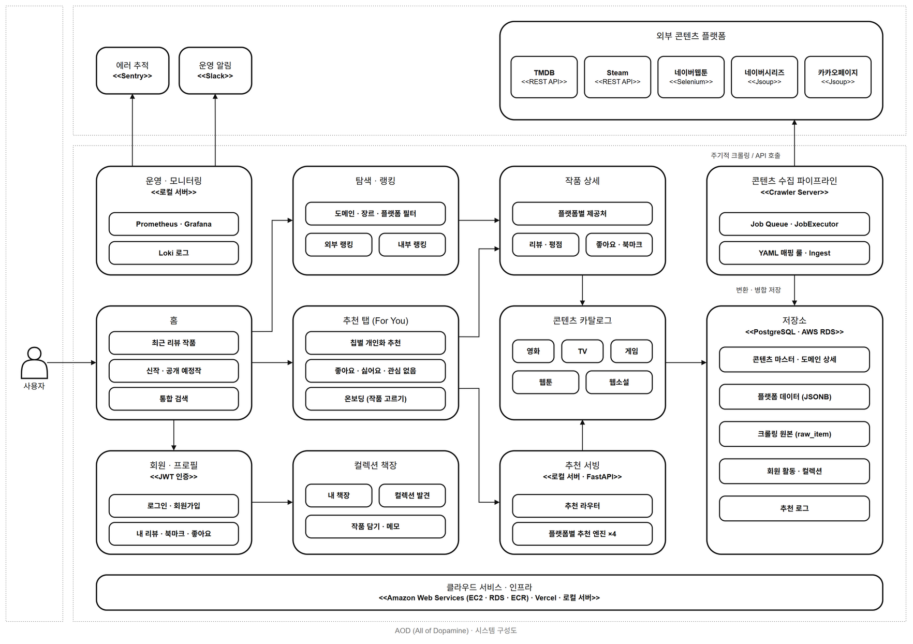
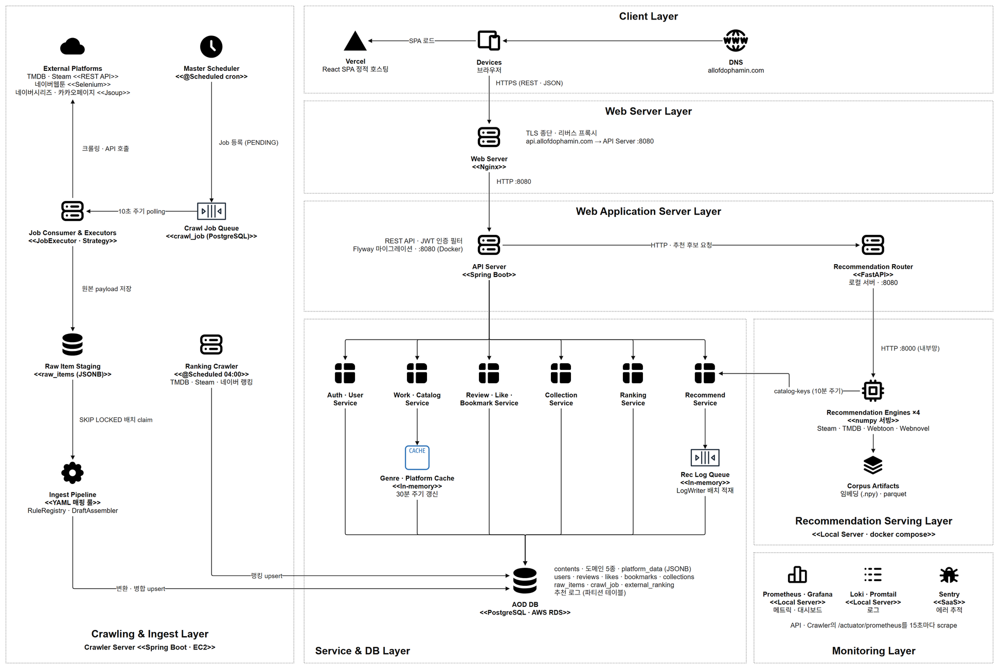
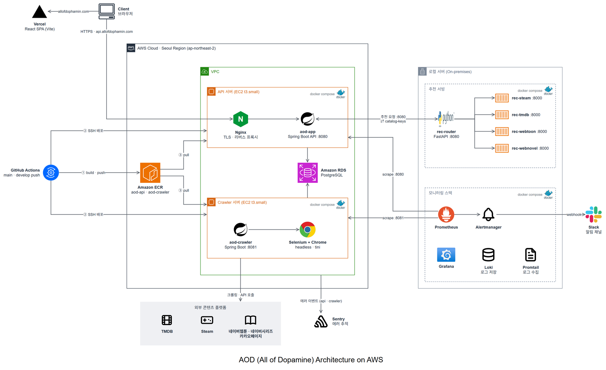
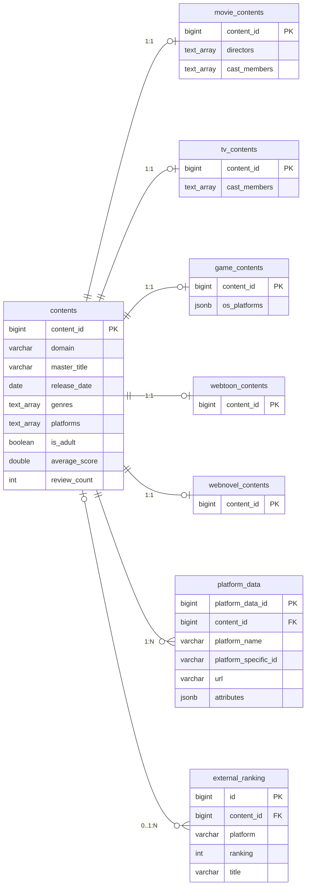
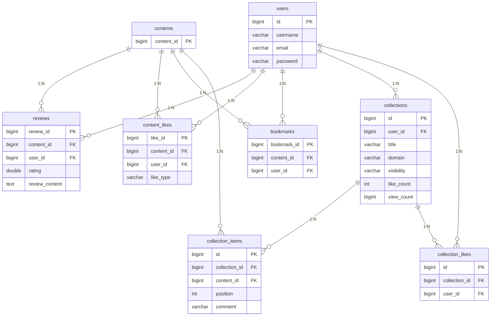
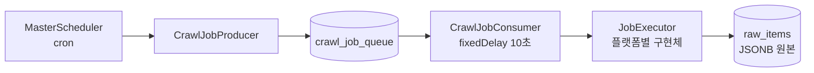
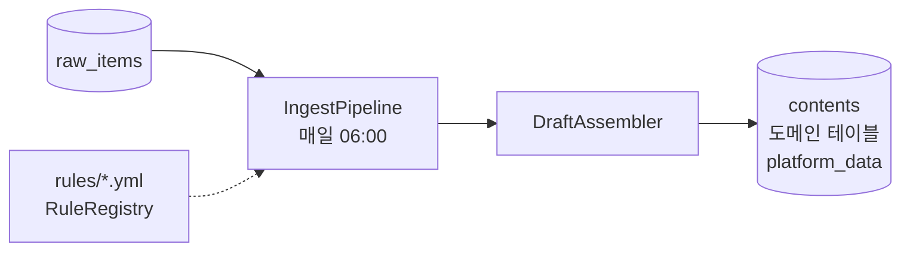
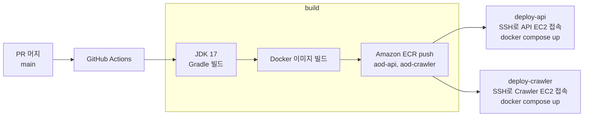

<div align="center">

# AOD (All of Dopamine) Backend

     

> 영화 · TV · 게임 · 웹툰 · 웹소설을 한 곳에서 탐색하고 추천받는 통합 콘텐츠 서비스 <br> 가톨릭대학교 창업동아리 팀 프로젝트입니다. · 서비스: <https://allofdophamin.com>

</div>

## 목차

- [1. 프로젝트 개요](#1-프로젝트-개요)
  - [1-1. 프로젝트 소개](#1-1-프로젝트-소개)
  - [1-2. 시스템 구성도](#1-2-시스템-구성도)
  - [1-3. 주요 기능](#1-3-주요-기능)
  - [1-4. 개발 환경](#1-4-개발-환경)
- [2. 개발 결과물](#2-개발-결과물)
  - [2-1. 백엔드 아키텍처](#2-1-백엔드-아키텍처)
  - [2-2. AWS 아키텍처](#2-2-aws-아키텍처)
  - [2-3. 데이터베이스 ERD 및 RDB 구조](#2-3-데이터베이스-erd-및-rdb-구조)
  - [2-4. API 서버 개발 및 API 문서화](#2-4-api-서버-개발-및-api-문서화)
  - [2-5. 테스트](#2-5-테스트)
  - [2-6. 크롤링 Job Queue](#2-6-크롤링-job-queue)
  - [2-7. YAML 매핑 룰 기반 Ingest 파이프라인](#2-7-yaml-매핑-룰-기반-ingest-파이프라인)
  - [2-8. 추천 API와 행동 로그](#2-8-추천-api와-행동-로그)
  - [2-9. CI/CD 파이프라인](#2-9-cicd-파이프라인)
  - [2-10. 모니터링](#2-10-모니터링)
- [3. 수행 방법 및 프로젝트 관리](#3-수행-방법-및-프로젝트-관리)
  - [3-1. 개발 프로세스](#3-1-개발-프로세스)
  - [3-2. 형상 관리 프로세스](#3-2-형상-관리-프로세스)

## 1. 프로젝트 개요

### 1-1. 프로젝트 소개

AOD(All of Dopamine)는 영화, TV(OTT), 게임, 웹툰, 웹소설 정보를 여러 플랫폼에서 수집해 하나의 카탈로그로 합치고, 그 위에서 탐색 · 랭킹 · 리뷰 · 컬렉션 · 개인 맞춤 추천을 제공하는 서비스입니다.

콘텐츠가 플랫폼마다 흩어져 있어 "볼 것"을 찾으려면 앱을 여러 개 오가야 하는 문제를 풀고자 했습니다. TMDB, Steam, 네이버웹툰, 네이버시리즈 등에서 수집한 원본 데이터를 공통 스키마로 정규화하여, 도메인과 플랫폼이 달라도 같은 화면에서 필터링하고 비교할 수 있습니다.

프로젝트는 세 개의 저장소로 구성됩니다.

| 저장소 | 역할 |
|--------|------|
| [-AOD-All-of-Dopamine-back](https://github.com/AOD-All-of-Dopamine/-AOD-All-of-Dopamine-back) | REST API 서버, 크롤러 · 배치 변환 서버 (이 저장소) |
| [-AOD-All-of-Dopamine-front](https://github.com/AOD-All-of-Dopamine/-AOD-All-of-Dopamine-front) | React 웹 클라이언트 |
| [-AOD-All-of-Dopamine-AI](https://github.com/AOD-All-of-Dopamine/-AOD-All-of-Dopamine-AI) | 추천 모델 및 추천 서빙 서버 |

### 1-2. 시스템 구성도



### 1-3. 주요 기능

<!-- TODO: 서비스 화면 스크린샷(홈 · 탐색 · 작품 상세 · 추천 탭 · 컬렉션 책장)을 images/ 에 추가하고 여기에 넣기 -->

| 기능 | 설명 |
|------|------|
| 홈 | 오늘의 작품, 최근 리뷰가 달린 작품, 신작, 주목작, 출시 예정작을 제공합니다. |
| 탐색 · 검색 | 도메인(영화 / TV / 게임 / 웹툰 / 웹소설), 장르, 플랫폼, 정렬 조건을 조합해 작품을 찾습니다. TMDB의 시청 가능 플랫폼 정보를 이용해 OTT별 필터도 제공합니다. |
| 랭킹 | 외부 플랫폼의 인기 순위를 매일 수집하여 플랫폼 · 도메인별로 제공하고, 일별 기록으로 순위 변동을 보여줍니다. |
| 작품 상세 | 플랫폼별 링크와 부가 정보, 리뷰 · 평점, 좋아요 / 싫어요, 북마크를 제공합니다. |
| 컬렉션 책장 | 작품을 모아 책장 형태의 컬렉션을 만들고, 순서 변경 · 메모 · 공개 범위 설정 · 좋아요를 지원합니다. |
| 추천 탭 (For You) | 좋아요 · 북마크 · 높은 평점의 리뷰를 바탕으로 개인화 추천을 제공합니다. 싫어요와 "관심 없음" 표시가 추천에 반영되며, 가입 직후 온보딩에서 좋아하는 작품을 고를 수 있습니다. |
| 회원 · 프로필 | JWT 기반 인증, 내 리뷰 · 북마크 · 좋아요 목록을 제공합니다. |

### 1-4. 개발 환경

- Back-end: `Java 17`, `Spring Boot 3`, `Spring Security`, `Spring Data JPA`, `Flyway`, `PostgreSQL`, `Selenium 4`, `Jsoup`, `WebFlux`, `Gradle 멀티모듈`
- Front-end: `TypeScript`, `React 18`, `Vite`, `TanStack Query`, `React Router`, `Tailwind CSS`, `pnpm 모노레포`
- AI / 추천 서빙: `Python`, `FastAPI`, `NumPy`, `Docker Compose`
- Infra: `AWS EC2`, `AWS RDS`, `AWS ECR`, `Vercel`, `Nginx`, `Docker`, `GitHub Actions`
- Monitoring: `Prometheus`, `Grafana`, `Loki`, `Promtail`, `Alertmanager`, `Sentry`, `k6`

## 2. 개발 결과물

### 2-1. 백엔드 아키텍처



시스템 구성도를 기반으로 백엔드 아키텍처를 설계하였습니다. 사용자 요청을 처리하는 경로(Client → Web Server → API Server → Service & DB)와 데이터를 수집하는 경로(Crawling & Ingest), 추천 서빙, 모니터링을 레이어로 분리하였습니다.

백엔드는 Gradle 멀티모듈로 구성하여, 수집 부하가 큰 크롤러와 사용자 요청을 받는 API 서버를 별도 프로세스로 배포합니다. 두 서버는 `shared` 모듈의 엔티티와 리포지토리를 공유하며, 같은 PostgreSQL을 바라봅니다.

| 모듈 | 역할 | 포트 |
|------|------|------|
| `-AOD-All-of-Dopamine-shared` | JPA 엔티티 · 리포지토리 공유 라이브러리 | - |
| `-AOD-All-of-Dopamine-api` | REST API 서버 (인증, 작품, 리뷰, 컬렉션, 랭킹, 추천) | 8080 |
| `-AOD-All-of-Dopamine-crawler` | 크롤링 · 배치 변환 서버, 관리자 화면 | 8081 |

새 플랫폼이나 도메인이 추가되어도 기존 코드를 수정하지 않는 것(OCP)을 설계 원칙으로 삼았습니다. 크롤러는 `JobExecutor` 인터페이스 구현체를 추가하는 것으로, 변환 규칙은 YAML 파일을 추가하는 것으로 확장합니다.

### 2-2. AWS 아키텍처



백엔드 아키텍처를 기반으로 AWS 배포 구조를 구성하였습니다.

- 프론트엔드는 Vercel에서 정적으로 호스팅하고, API 요청은 Nginx 리버스 프록시를 거쳐 API 서버(Spring Boot)로 전달됩니다.
- API 서버와 크롤러 서버는 서로 다른 EC2 인스턴스에서 Docker 컨테이너로 구동합니다. Selenium / Chrome을 쓰는 크롤러의 부하가 API 응답에 영향을 주지 않도록 분리하였습니다.
- 데이터베이스는 AWS RDS(PostgreSQL)를 사용하며, 두 서버가 함께 사용합니다.
- 컨테이너 이미지는 GitHub Actions에서 빌드하여 Amazon ECR(`aod-api`, `aod-crawler`)에 올리고, 각 EC2가 내려받아 실행합니다.
- 추천 서빙(rec-router와 도메인별 엔진 4종)과 모니터링 스택은 AWS가 아닌 별도의 로컬 서버에서 Docker Compose로 구동하는 구성입니다.

### 2-3. 데이터베이스 ERD 및 RDB 구조

**콘텐츠 카탈로그**



**사용자 활동**



**수집 파이프라인** (다른 테이블과 FK로 연결하지 않습니다)

| 테이블 | 주요 컬럼 | 역할 |
|--------|-----------|------|
| `crawl_job_queue` | `job_type`, `target_id`, `status`, `priority`, `retry_count` | 크롤링 작업 큐 |
| `raw_items` | `hash`(UNIQUE), `source_payload`(JSONB), `platform_specific_id`, `processed_at` | 크롤링 원본 스테이징 |

> 주요 컬럼만 표기하였습니다. `text_array` 는 PostgreSQL `text[]` 타입입니다.

도메인이 달라도 공통으로 다루는 정보는 마스터 테이블 `contents`에 두고, 도메인 전용 정보는 `movie_contents` 등 1:1 테이블로, 플랫폼별 정보는 `platform_data`(1:N)로 나누는 3계층 구조로 설계하였습니다.

- **도메인 테이블**: `@MapsId`로 `contents`의 PK를 그대로 공유합니다. ID가 이미 채워진 신규 엔티티를 JPA가 UPDATE 대상으로 오판하지 않도록, 모든 도메인 엔티티가 `Persistable<Long>`을 구현합니다.
- **플랫폼 고유 속성**: 플랫폼마다 형태가 다른 값은 `platform_data.attributes`(JSONB)에 저장하여, 플랫폼이 추가되어도 스키마를 변경하지 않습니다.
- **배열 컬럼과 GIN 인덱스**: 장르 · 플랫폼은 `text[]` 컬럼으로 두고, GIN 인덱스와 `@>` 연산자로 다중 조건 필터링을 처리합니다.
- **스테이징 테이블**: 크롤링 원본은 `raw_items`에 JSONB로 먼저 적재한 뒤 변환합니다. `hash` 유니크 제약으로 같은 원본의 중복 적재를 막습니다.
- **중복 방지 제약**: 리뷰 · 좋아요 · 북마크는 `(content_id, user_id)`, 컬렉션 항목은 `(collection_id, content_id)` 유니크 제약을 둡니다.
- **추천 스키마 분리**: 추천 서빙 상태(`aod_rec`)와 행동 로그(`aod_log`)는 별도 스키마로 분리하였습니다. 로그 테이블은 월 단위 RANGE 파티션으로 구성하고, 보관 기간이 지난 파티션을 통째로 제거합니다.

스키마 변경은 Flyway 마이그레이션(`-AOD-All-of-Dopamine-api/src/main/resources/db/migration`)으로 관리합니다.

### 2-4. API 서버 개발 및 API 문서화

API 서버는 Java 17과 Spring Boot 기반으로 개발하였으며, 인증은 Spring Security와 JWT로 처리합니다.

| 구분 | 엔드포인트 |
|------|-----------|
| 인증 | `POST /api/auth/signup` · `POST /api/auth/login` · `POST /api/auth/check-duplicate` · `GET /api/auth/me` |
| 작품 | `GET /api/works` · `GET /api/works/{id}` · `GET /api/works/releases/recent` · `GET /api/works/releases/upcoming` · `GET /api/works/releases/notable` · `GET /api/works/featured-today` · `GET /api/works/recent-reviews` · `GET /api/works/genres` · `GET /api/works/genres-with-count` · `GET /api/works/platforms` |
| 리뷰 | `GET` `POST /api/works/{contentId}/reviews` · `PUT` `DELETE /api/reviews/{reviewId}` · `GET /api/my/reviews` |
| 좋아요 · 북마크 | `POST /api/works/{contentId}/like` · `POST /api/works/{contentId}/dislike` · `POST /api/works/{contentId}/bookmark` · `GET /api/my/likes` · `GET /api/my/bookmarks` |
| 컬렉션 | `GET` `POST /api/collections` · `GET /api/collections/mine` · `GET` `PATCH` `DELETE /api/collections/{id}` · `POST /api/collections/{id}/items` · `PUT /api/collections/{id}/items/order` · `POST` `DELETE /api/collections/{id}/like` |
| 랭킹 | `GET /api/rankings/all` · `GET /api/rankings/{platform}` · `GET /api/rankings/domain/{domain}` |
| 추천 | `GET /api/recommendations` · `PUT /api/works/{contentId}/reaction` · `PUT` `DELETE /api/recommendations/not-interested/{contentId}` |

**Spring REST Docs**

API 문서는 Spring REST Docs로 작성합니다. 컨트롤러 테스트(`*ControllerDocsTest`)가 통과해야 스니펫이 생성되므로, 문서와 실제 동작이 어긋나지 않습니다. 테스트를 포함해 빌드하면 Asciidoctor가 문서를 만들어 실행 JAR의 `static/docs`에 포함합니다.

<!-- TODO: REST Docs 문서 화면 스크린샷 추가 -->

### 2-5. 테스트

JUnit 5 기반으로 78개 테스트 클래스, 459개의 테스트를 작성하였습니다(API 59개 클래스, 크롤러 19개 클래스).

- **단위 테스트**: 서비스 로직과 추천 도메인의 구성 요소(시드 결정, 체인, 대체 응답, 서킷 브레이커, 이벤트 검증 등)를 검증합니다.
- **통합 테스트**: 추천 API와 로그 적재는 Testcontainers로 실제 PostgreSQL을 띄워, 파티션 테이블과 배열 · JSONB 컬럼처럼 PostgreSQL에 의존하는 동작을 검증합니다.
- **마이그레이션 계약 테스트**: Flyway 마이그레이션 파일의 내용이 코드와 맞는지 확인하고, 실제 실행 결과는 통합 테스트에서 검증합니다.
- **매핑 룰 테스트**: 운영에 쓰는 YAML 룰 파일 전체가 로드 · 검증을 통과하는지, 변환 결과가 기대값(골든 값)과 같은지 확인합니다.
- **API 문서 테스트**: REST Docs 스니펫을 생성하는 컨트롤러 테스트입니다.

부하 테스트는 k6 스크립트로 작성하였습니다. 스모크 테스트, 크롤러 부하 테스트, API 부하 테스트 시나리오와 임계값은 [k6/README.md](./k6/README.md)에 정리되어 있습니다.

### 2-6. 크롤링 Job Queue



수집 대상이 많은 플랫폼을 한 번에 크롤링하면 대상 서버에 부하를 주고 차단될 수 있어, PostgreSQL 테이블을 큐로 쓰는 Producer–Consumer 구조로 구성하였습니다.

- **Producer**: 스케줄러가 수집 대상을 `crawl_job_queue`에 `PENDING` 상태로 적재하고 즉시 반환합니다. 같은 작업 유형과 대상 ID가 이미 있으면 적재하지 않습니다.
- **Consumer**: 10초 간격(`fixedDelay`)으로 대기 중인 작업을 우선순위 순으로 꺼내 처리합니다. 한 번에 꺼내는 개수는 Executor의 평균 처리 시간에 맞춰 정해지며, 실패한 작업은 최대 3회까지 재시도합니다.
- **JobExecutor (Strategy Pattern)**: 플랫폼별 수집 로직은 `JobExecutor` 구현체로 분리하였습니다. 구현체를 추가하면 자동으로 등록되어 Consumer 코드를 수정하지 않아도 됩니다. 현재 TMDB(영화 / TV), Steam, 네이버웹툰(연재 / 완결), 네이버시리즈 Executor가 있습니다.
- **Selenium 자원 관리**: WebDriver는 스레드별로 재사용하다가 일정 횟수가 지나면 교체합니다. 컨테이너에서는 `tini`를 PID 1로 두어 종료된 Chrome 자식 프로세스가 좀비로 남지 않도록 하였습니다.

### 2-7. YAML 매핑 룰 기반 Ingest 파이프라인



플랫폼마다 다른 원본 JSON을 공통 스키마로 옮기는 규칙을 코드가 아닌 YAML 파일로 선언하였습니다. 새 플랫폼은 Java 코드를 수정하지 않고 룰 파일 하나를 추가하는 것으로 연결됩니다.

```yaml
# rules/movie/tmdb_movie.yml (일부)
platformName: TMDB_MOVIE
domain: MOVIE
schemaVersion: 4

mappings:
  title:            master.masterTitle       # contents
  release_date:     master.releaseDate
  genres:           master.genres
  runtime:          domain.runtime           # movie_contents
  movie_details.id: platform.platformSpecificId   # platform_data
  watch_providers:  attr.watch_providers     # platform_data.attributes (JSONB)

normalizers:
  master.masterTitle: [collapse_spaces, nfkc]

platformsFrom:
  - watch_providers
```

- 목적지는 접두사로 구분합니다: `master.*`(contents) / `domain.*`(도메인 테이블) / `platform.*`(platform_data) / `attr.*`(JSONB 속성).
- `RuleRegistry`가 기동 시 모든 룰 파일을 읽어 검증하므로, 룰의 오타는 런타임 오류가 아니라 부팅 실패로 드러납니다.
- `DraftAssembler`가 원본 JSON을 `Content` + 도메인 엔티티 + `PlatformData`로 조립하고, 이미 있는 작품이면 병합하여 저장합니다.
- 변환 대상 행은 `FOR UPDATE SKIP LOCKED`로 선점하여, 여러 워커가 같은 원본을 동시에 처리하지 않습니다.

룰 파일은 `-AOD-All-of-Dopamine-crawler/src/main/resources/rules/`에 도메인별로 있습니다. 자세한 내용은 [docs/3_TRANSFORM_ENGINE.md](./docs/3_TRANSFORM_ENGINE.md), [docs/8_INGEST_PIPELINE_TRACE.md](./docs/8_INGEST_PIPELINE_TRACE.md)를 참고하세요.

### 2-8. 추천 API와 행동 로그

추천 모델과 서빙 서버는 [AI 저장소](https://github.com/AOD-All-of-Dopamine/-AOD-All-of-Dopamine-AI)에 있으며, API 서버는 추천 요청을 조립하고 결과를 카드로 가공하는 역할을 맡습니다.

- **시드 결정**: 좋아요 · 북마크 · 평점 4 이상 리뷰를 시드로 삼고, 싫어요와 평점 2 이하 리뷰는 제외합니다. 시드의 출처(좋아요 > 리뷰 > 북마크 순)는 추천 이유 문구에도 쓰입니다.
- **추천 라우터 호출**: 세마포어로 동시 호출 수를 제한하고 타임아웃을 둡니다. 라우터 응답을 기다리는 동안 DB 커넥션을 쥐고 있지 않도록, 이 구간은 트랜잭션으로 묶지 않았습니다.
- **서킷 브레이커와 대체 응답**: 연속 10회 실패하면 30초간 호출을 차단하고, 이후 1건으로 복구 여부를 시험합니다. 시드 없음 · 라우터 실패 · 타임아웃 등 추천을 줄 수 없는 모든 경우에는 외부 랭킹 기반의 대체 목록을 같은 응답 형태로 내려, 추천 서버 장애가 화면 장애로 번지지 않습니다.
- **체인 상태**: 이어 보기(페이지네이션) 중 이미 보여준 작품이 다시 나오지 않도록, 서빙 상태를 `aod_rec` 스키마에 동기로 기록합니다.
- **행동 로그**: 요청 스레드는 이벤트를 메모리 큐에 넣기만 하고, 적재 스레드가 1초 또는 200건마다 전용 커넥션 풀로 `aod_log` 스키마에 배치 INSERT합니다. 로그는 유실되어도 추천 결과가 틀려지지 않는 경로이므로, 큐가 가득 차거나 쓰기에 실패하면 버리고 개수만 셉니다.
- **파티션 관리**: 로그 테이블은 월 단위 파티션입니다. 매일 실행되는 작업이 이후 달의 파티션을 미리 만들고, 보관 기간이 지난 파티션을 삭제합니다.

### 2-9. CI/CD 파이프라인



GitHub Actions로 빌드부터 배포까지 자동화하였습니다([.github/workflows/main.yml](./.github/workflows/main.yml)).

- `build` 잡이 Gradle로 두 서버를 빌드하고 Docker 이미지를 만들어 Amazon ECR에 올립니다. ECR 저장소가 없으면 생성합니다.
- `deploy-api`, `deploy-crawler` 잡이 빌드 성공 후 병렬로 실행됩니다. 필수 시크릿을 먼저 확인한 뒤 SSH로 각 EC2에 접속하여 새 이미지를 받아 Docker Compose로 컨테이너를 교체합니다.
- 배포 후 컨테이너 상태와 최근 로그를 출력하여, 워크플로 화면에서 기동 여부를 확인할 수 있습니다.

<!-- TODO: GitHub Actions 실행 화면 스크린샷 추가 -->

### 2-10. 모니터링

**Reference**: [monitoring/README.md](./monitoring/README.md), [docs/7_MONITORING.md](./docs/7_MONITORING.md)

- **메트릭**: Spring Boot Actuator와 Micrometer로 메트릭을 노출하고, Prometheus가 수집하여 Grafana 대시보드로 확인합니다. 크롤링 큐의 상태별 작업 수도 커스텀 메트릭으로 내보냅니다.
- **로그**: Promtail이 애플리케이션 로그를 Loki로 보내고, Grafana에서 조회합니다.
- **알림**: Prometheus 알림 규칙에 걸리면 Alertmanager가 Slack으로 알립니다.
- **에러 추적**: API 서버와 크롤러 모두 Sentry SDK를 적용하였습니다.

Prometheus, Grafana, Loki, Alertmanager 설정과 대시보드는 `monitoring/` 디렉터리에서 코드로 관리합니다.

<!-- TODO: Grafana 대시보드 스크린샷 추가 -->

## 3. 수행 방법 및 프로젝트 관리

### 3-1. 개발 프로세스

<!-- TODO: 팀 구성, 스프린트 방식, 이슈 관리 도구(스크린샷 포함)를 여기에 추가 -->

규모가 큰 변경은 설계 문서(spec)와 구현 계획(plan)을 먼저 작성한 뒤 구현하였습니다. Ingest 파이프라인 재작성, 크롤러 표준화 작업이 이 방식으로 진행되었으며, 문서는 [docs/superpowers](./docs/superpowers)에 남아 있습니다.

기능이 큰 작업은 독립적으로 머지할 수 있는 단위로 나누었습니다. 추천 탭은 로그 기반 → 이벤트 트래커 → 추천 서빙 → 추천 API → 추천 탭 화면 → 온보딩의 여섯 단계로 나누어 순서대로 머지하였습니다.

### 3-2. 형상 관리 프로세스

프로젝트의 형상 관리에는 Git과 GitHub를 사용하였습니다. `feature/*`, `perf/*`, `refactor/*`, `chore/*` 브랜치에서 작업한 뒤 PR을 통해 `main`에 머지하며, `main`에 반영되면 CI/CD 파이프라인이 배포까지 수행합니다.

PR은 템플릿([PULL_REQUEST_TEMPLATE.md](./.github/PULL_REQUEST_TEMPLATE.md))으로 형식을 통일하였습니다. 관련 이슈 번호, 작업 내용, 리뷰어에게 공유할 사항을 적고 팀원 한 명을 리뷰어로 지정합니다.
